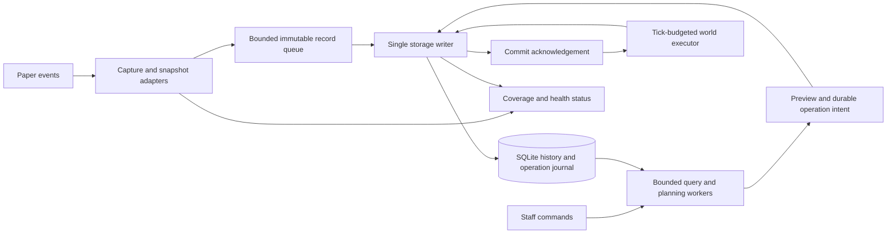

# Architecture

Status: 13 November 2026. M1/M2 are implemented; M3 adds schema-3 journals, frozen plans and conservative inert stone/air recovery, qualified on the pinned runtime by local and Linux/Windows suites. [RECOVERY.md](RECOVERY.md) defines actual recovery behaviour and development bounds. Broader codecs, performance tuning and retention remain proposals. The [first evaluation alpha](releases/v0.1.0-alpha.1.md) remains M1/M2 only. Stable-release gates remain unmet.

## Repository evidence and decisions

The initial repository inspection found one commit, `611d983` (11 November 2026), with `README.md` and an MIT `LICENSE`. At that point there were no source/build files, tests, workflows, earlier architecture or release tags. The remote is `https://github.com/D3V-X3N0/Chronicle.git`. The documentation and first bootstrap followed that greenfield baseline; preserve the existing license and attribution. This is historical inspection evidence, not the current file inventory.

| Decision for the initial design | Reason and trade-off |
| --- | --- |
| Paper/Minecraft 26.3 build 248, Java 25; Gradle 9.9.1 | First build's verified artifact pins; runtime capture/recovery compatibility still requires its own evidence |
| One Gradle project with package boundaries | Enough separation for testing without premature multi-module or service architecture |
| Conventional `plugin.yml`, public Paper API | Avoid internal server mappings and experimental plugin loading unless a demonstrated need appears |
| SQLite through JDBC, one writer, bounded readers | Simple local deployment and explicit transaction ownership; one write throughput ceiling |
| WAL and `synchronous=FULL` | Protect committed transactions; still cannot protect records only in memory |
| Immutable history plus separate recovery journal | Original evidence survives rollback; extra storage buys auditability and recovery context |
| Conservative, previewed rollback; one operation at a time | Easier conflict and recovery reasoning; limits concurrency |
| Folia excluded from the first release | Region ownership and cross-region operations need separate design and testing |

The [Paper setup guide](https://docs.papermc.io/paper/dev/project-setup/), [downloads](https://papermc.io/downloads/paper), and [plugin descriptor reference](https://docs.papermc.io/paper/dev/plugin-yml/) support the platform choice. The first build resolves API `26.3.build.248-stable` and pins matching server build 248 plus its SHA-256. These pins replace the earlier unresolved dependency proposal; they do not qualify logging or recovery. Source checks are dated 11 November 2026.

## Responsibilities and data flow

Arrows across thread boundaries carry immutable values or completion messages, never live world objects. A commit acknowledgement enables a later server-thread task; it does not make the writer call the world executor directly.

| Package responsibility | Owns | Must not own |
| --- | --- | --- |
| `bootstrap` / `config` | Plugin lifecycle, validated settings, executor wiring | Business rules hidden in the plugin entry point |
| `capture` | Paper listeners, snapshot extraction, causality evidence, per-location revisions | SQL, blocking I/O, claims that every event is a completed mutation |
| `model` | Immutable identities, change records, snapshot envelopes, filters | Bukkit/Paper objects or database connections |
| `storage` / `storage.sqlite` | Queue admission, batches, migrations, repositories, durability cursors | World access or arbitrary SQL exposed to commands |
| `query` | Filter validation, bounded searches, pagination, name-to-UUID resolution | Unbounded result lists or retained live database cursors |
| `rollback` | Pure planning, conflicts, journal state machine, restoration | Paper-specific mutation outside the executor adapter |
| `platform.paper` | Thread-checked snapshot/apply adapters, scheduler integration | A speculative multi-platform abstraction hierarchy |
| `command` / `diagnostics` | Permissions, messages, health/operation views | Silently converting storage failure to empty results |

Use explicit constructor dependencies and small interfaces where they enable fake storage/world adapters in tests. Start with repository methods for concrete use cases, not a generic ORM or backend framework. A future SQL backend can reuse domain and query contracts while retaining backend-specific transactions, migrations, and indexing.

### Thread ownership

World reads/writes, block and inventory snapshots, entity/player access, and command responses that touch Paper objects run on the Paper server thread. Capture makes bounded immutable copies there. Pure encoding/compression may move to workers only after all required API-derived data has been copied safely. Do not pass `Block`, `BlockState`, `Inventory`, `ItemStack`, `Player`, or a mutable collection to a worker and assume cloning makes API methods thread-safe.

JDBC, file operations, database maintenance, filtering, and pure planning run on dedicated bounded workers. One writer owns its connection and prepared statements. Readers have separate connections, short transactions, deadlines, and cancellation. Never use the common fork-join pool or an unbounded task queue for storage. Server callbacks must not call `join()`/`get()` on database work. Shutdown is the sole bounded drain exception, with no worker dependency on server-thread tasks.

This follows Paper's [scheduler threading guidance](https://docs.papermc.io/paper/dev/scheduler/). Folia's [separate scheduler and ownership requirements](https://docs.papermc.io/paper/dev/folia-support/) are a future research task; do not declare `folia-supported: true`.

## Event capture and state fidelity

### Observation contract

1. Register observational handlers at `MONITOR` with cancelled events ignored where the event contract permits. Also honour event-specific denial such as placement's build flag. Never change an event in a monitoring handler. [`EventPriority`](https://jd.papermc.io/paper/26.3/org/bukkit/event/EventPriority.html) defines monitoring as observation; this is not a universal post-commit hook.
2. On the owning thread, extract the event's pre-state and any proposed post-state before returning. A placement offers a replaced state; breaking fires before destruction, so the current block is not its final post-state. See [`BlockPlaceEvent`](https://jd.papermc.io/paper/26.3/org/bukkit/event/block/BlockPlaceEvent.html) and [`BlockBreakEvent`](https://jd.papermc.io/paper/26.3/org/bukkit/event/block/BlockBreakEvent.html).
3. Assign a session-local capture sequence and group ID. Use adapter-specific completion evidence established on the pinned runtime. Reconciliation may use the next relevant observation and a bounded subsequent server-thread check. Do not assume a next-tick sample identifies every intermediate state: multiple mutations can happen in the same tick.
4. Resolve pending observations in capture order. Finalised records distinguish complete transitions, partial/ambiguous evidence, and no change. If the post-state or causal chain cannot be established, retain inspection-only evidence or an explicit coverage incident with a reason; M1 uses bounded global incident aggregates. Do not fabricate air as a generic break result. Pending buffers count against admission limits and expire to explicit uncertainty.
5. Admit each complete group atomically to the queue. Deduplicate by capture identity and adapter ownership, not by matching location/time/material. A real `A -> B -> A` sequence must retain both changes. One placement adapter handles both ordinary and multi-place events to avoid superclass/subclass duplication.

The first capture spike must prove these steps for a small allowlist of simple blocks before declaring reliable logging. Later plugins can violate monitoring conventions or mutate blocks without events; Chronicle cannot turn the public event API into a complete transaction log. Expose known ambiguity and configuration coverage instead of claiming universal detection.

### Planned coverage

| Event family / candidate hooks | Minimum scope or later stage | Evidence and safety concerns |
| --- | --- | --- |
| `BlockPlaceEvent`, `BlockBreakEvent` | M1/M2 direct player actions | UUID actor, replaced/pre-break state, validated final state; cancelled/denied/no-op paths; survival and creative |
| `BlockMultiPlaceEvent` | M1/M2 investigate; qualify separately | All replaced states form one logical group; beds/doors cannot be undone half at a time. The API explicitly exposes a multi-block action. [Reference](https://jd.papermc.io/paper/26.3/org/bukkit/event/block/BlockMultiPlaceEvent.html) |
| Container block placement/destruction | M1/M2 classify; later complete codecs | Preserve available metadata for investigation, but mark incomplete payloads; inventory contents and dropped items make recovery unsafe initially |
| `EntityExplodeEvent`, `BlockExplodeEvent` | M4 | Final affected-block list after cancellation/list edits, before snapshots, multi-block grouping, drops and source entity; explosion priming alone is not damage |
| `BlockGrowEvent`, `BlockFormEvent`, `BlockSpreadEvent`, `BlockFadeEvent`, `LeavesDecayEvent`, `StructureGrowEvent`, piston events | M4, independently gated | Proposed versus actual state, shared handler inheritance, source/destination movement, dependent blocks, limited causal evidence |
| `BlockFromToEvent`, `FluidLevelChangeEvent`, player bucket events, sponge absorption | M4 | Flow destinations, source changes, waterlogging and cascades; a bucket's player is not automatically the actor for all later fluid damage |
| `BlockIgniteEvent`, `BlockBurnEvent`, relevant spread events | M4 | Ignition is not destruction; record distinct actions, preserve cause only when known |
| Inventory click/drag, creative actions, hopper move/pickup events | M4 logging only | Actual slot deltas, multiple viewers, cancellation, partial movement, double chests and item metadata |
| `EntityChangeBlockEvent`, hanging/item-frame events, entity placement/removal | M4 selective logging | Source UUID/type and location where meaningful; arbitrary entity state restoration remains excluded |

`BlockPhysicsEvent` is neither an exhaustive change stream nor a cheap fallback: its [documentation](https://jd.papermc.io/paper/26.3/org/bukkit/event/block/BlockPhysicsEvent.html) warns about frequency and omitted dependent updates. Do not register broad physics snapshots by default. Settings or other plugins that disable relevant events must be part of the support matrix; mark coverage limited when detectable.

### Snapshot format and causality

Propose a versioned envelope with material namespaced key, complete block-data representation, codec version, Minecraft data version, payload kind, completeness flag/reason, and bounded payload bytes. An allowlisted block-entity codec adds all metadata needed for a faithful round trip, for example sign text or container slots, names and locks. A partial snapshot remains inspectable but not restorable. Unknown versions are retained, never coerced or automatically downgraded.

Capture metadata before destructive changes. For inventories, copy slot numbers and full item data, including stack amount, components and persistent data; name/type/amount alone is insufficient. Use supported Paper serialization facilities where available, validated per version; do not persist Java native object serialization or invent a universal block NBT codec. Hash canonical payloads to accelerate comparisons, then compare full canonical content before applying. Mutable snapshot objects never constitute persisted history.

Use actor kind (`PLAYER`, `ENTITY`, `ENVIRONMENT`, `SYSTEM`, `UNKNOWN`), optional UUID, display name at capture, cause kind, optional source change/entity identity, and evidence quality (`DIRECT`, `DERIVED`, `UNKNOWN`). Derived links require explicit tested evidence, such as an identified projectile shooter. Last-touch or nearby-player heuristics must not become responsibility claims. A shared cause ID groups related observations without assigning all of them to one player.

### Inventory transaction research gate

Inventory callbacks describe activity during a transaction, not a durable committed transfer. Click events also exclude drags; see [`InventoryClickEvent`](https://jd.papermc.io/paper/26.3/org/bukkit/event/inventory/InventoryClickEvent.html). The accessible [26.2 hopper event contract](https://jd.papermc.io/paper/26.2/org/bukkit/event/inventory/InventoryMoveItemEvent.html) notes that removal may already have occurred when the event fires. The corresponding 26.3 page could not be retrieved during research; M4 must inspect the pinned 26.3 source/API before relying on it.

Maintain a bounded ordered observation stream per inventory identity, reconcile actual slot deltas, and group both sides of a qualified transfer. Identify block inventories by world/position and physical half/slot mapping; use entity UUIDs for entity inventories. Treat shift-click, hotbar swap, double-click, drag, creative edits, concurrent viewers, hopper chains, pickups, furnaces and crafting outputs as distinct cases. Opening/closing a chest is not a transaction. A final net snapshot cannot attribute intermediate movements to one viewer; retain ambiguity if no reliable order can be proven. Do not recreate the entire vanilla transaction engine just to claim coverage. No inventory recovery ships until conservation, drop handling, and crash recovery have a separate proven design.

## Persistence

The current implementation uses Xerial 3.54.1.0 / SQLite 3.54.1, one connection-owning writer, two bounded read-only workers, and transactional schema 3. It isolates the bundled driver because Paper supplies an older SQLite. See [STORAGE.md](STORAGE.md) for the implemented schema, failure policy and shutdown limits. Query workers and frozen committed-ID lookup boundaries exist. M3 adds capture barriers, frozen plans, operation journals and one serialized recovery control slot on the writer. Bounded recovery SQL runs there to keep claims and history ordered; expensive planning can delay commits, so M5 still needs mixed-load measurements. Backup tooling and pruning remain future work.

### Admission, commit, and overload

Records pass through `observed -> finalised -> queued -> committed`. Only a successful SQLite transaction acknowledgement means committed. Track the latest resolved capture sequence, committed position, pending count/bytes, and oldest pending age. A writer barrier resolves all preceding capture slots (including explicit gaps) before a query/operation claims a coverage boundary. Ordinary lookup can show the last committed boundary immediately with lag; rollback requires a completed barrier and acceptable coverage.

Use limits on record count, bytes, pending reconciliation, and group size. Do not allocate an entire unbounded explosion or inventory payload before enforcing those limits. Batches use prepared statements and one transaction per bounded set of whole groups. Reuse statements within the connection owner. Retry the same immutable capture keys on transient busy errors, with a finite worker-side deadline and backoff; check payload identity if a key already exists. Never retry a failed batch as independently successful individual rows without recording its outcome.

High queue pressure first suspends optional lookups, pruning, and new recovery work. At full capacity or a storage error, refuse new admissions visibly; do not evict accepted records. Latch a degraded coverage incident, count rejected observations, record its earliest/latest known time and scope, and alert console/staff with rate limiting. Unknown scope means server-wide uncertainty. Use bounded aggregate incident state and reserved control capacity, not one emergency allocation per lost event. Persist incidents when storage recovers. The session was marked unclean before capture began, so a crash before that write still surfaces possible loss; exact rejected counts may be unavailable after a crash.

Default overload policy permits gameplay to continue, so this is explicitly an availability-over-completeness choice, never a lossless mode. Recovery affecting a gap or untrusted chain is refused. After recovery, new complete chains may become eligible only when they do not cross uncertainty; acknowledging an alert does not repair missing history. Blocking the server thread to drain the queue is rejected. A protective mode that cancels selected events is future work: cancellation cannot stop every world change, must use a separate appropriate-priority handler, and would still not make logging atomic.

### SQLite lifecycle and durability

Use a local database in the plugin data directory, one writer connection, and a small bounded set of query-only readers. SQLite WAL permits concurrent readers but still has a single writer; long readers impede checkpoints, and WAL requires local shared-memory coordination. Keep transactions short and let the writer schedule checkpoint work. Do not use a network filesystem. [SQLite WAL](https://www.sqlite.org/wal.html)

Set and read back `journal_mode=WAL`, `synchronous=FULL`, `foreign_keys=ON`, and a finite busy timeout on applicable connections. Do not assume an accepted pragma took effect. In WAL mode, `FULL` synchronises commits; `NORMAL` may lose committed transactions after OS/power failure. Chronicle therefore selects `FULL`; no `OFF` durability mode is planned. Hardware/filesystem sync honesty remains an external dependency. [SQLite pragmas](https://sqlite.org/pragma.html#pragma_synchronous)

Pin a maintained Xerial SQLite JDBC release and check `sqlite_version()` at runtime. Require SQLite 3.51.3 or newer for the initial baseline: SQLite documents a WAL-reset corruption fix there (with selected older backports). Do not rely on writer scheduling alone to compensate for an unfixed engine. [WAL-reset advisory, section 11](https://www.sqlite.org/wal.html)

No asynchronous memory queue survives process death. A separate durable ingress spool could reduce that window, but an asynchronous spool also has a window before its sync, while a synchronous spool adds capture latency. Defer it until measurement and recovery design justify the extra log; do not advertise zero loss. Database commit is also separate from world save durability.

Startup runs configuration checks, native-driver loading, migrations, recovery inspection, and creation of an unclean session before enabling capture. Until ready, report `STARTING` and unavailable history; record the startup coverage interval. A failed migration or corrupt database leaves Chronicle failed/disabled with a clear console message, not “healthy with zero rows”. Never replace a broken database with an empty one automatically.

On shutdown, stop new capture/query/operation requests on the server thread, finalise or explicitly mark pending observations uncertain, and stop world execution. Drain storage within the configured deadline. Workers must need no server-thread callbacks to finish. Mark the session clean only after accepted records, coverage incidents, and the operation pause state are committed; an operation can be paused in a cleanly stopped session. On timeout, report pending counts, leave the session unclean, and do not claim a completed flush. Close connections and executors without deleting WAL files.

On restart, inspect the last session and journal, permit SQLite's own recovery, and run appropriately bounded integrity diagnostics. Unclean sessions create a conservative uncertainty interval from the last durable coverage position through restart; its precise missing events are unknowable. Read-only diagnosis and backups precede repairs; corruption must never trigger silent salvage.

### Proposed logical schema

This is a design sketch, not migration SQL. Start M1 with sessions, identities, changes, coverage and migration tables; add operation tables in M3 and inventory detail in M4. Use integer surrogate keys for joins and stable UUID/text identities at boundaries. Avoid platform enum ordinals in persisted data.

| Table | Important fields / invariants |
| --- | --- |
| `schema_migrations` | Version PK, checksum, applied UTC time; ordered forward migrations |
| `sessions` | Monotonic session ID, start/stop times, clean flag, runtime versions, last committed capture sequence; clean flag starts false |
| `worlds` | ID PK, unique UUID, last known name; names are not identities |
| `actors` | ID PK, kind, optional UUID, last known name; each change also preserves the observed display name |
| `changes` | Non-reused integer ID, session ID, capture sequence, group ID/member index, UTC timestamp, world ID, X/Y/Z, chunk X/Z, action, actor/cause, evidence/completeness, before/after snapshot envelopes, optional operation ID |
| `coverage_incidents` | Session, interval/sequence bounds, world/region or global scope, cause, counts if known, recovery/acknowledgement state |
| `operations` | UUID PK, kind, requester UUID/console, immutable filters/selection boundary, preview hash/expiry, parent rollback ID, state, timestamps, counts and stop reason |
| `operation_steps` | Operation ID + ordinal PK, referenced change/group IDs, expected and desired snapshots, actual before/after, state/reason, source rollback step for restoration |
| `inventory_deltas` | Later: change/group ID, inventory identity, slot, before/after item envelopes, counterparty and certainty |

Enforce `UNIQUE(session_id, capture_sequence, member_index)` for idempotent insertion. The writer persists finalised capture groups in sequence order; database IDs are stable ingestion order, not wall-clock truth. Store timestamp separately for user filters; clock rollback or equal millisecond values cannot reverse causal order. A session ID orders restarts. IDs must not be reused after pruning. Partial snapshots carry explicit flags; SQL NULL cannot silently mean both air and unknown.

Initial candidate indexes on `changes` (proposals, evaluated against M2's committed-ID ordering):

- `(world_id, x, y, z, id)` for inspection, state chains and conflicts.
- `(world_id, chunk_x, chunk_z, occurred_at, id)` for bounded spatial selection.
- `(actor_id, occurred_at, id)` for player history.
- `(occurred_at, id)` for time queries and bounded retention.

Unique capture keys and foreign-key lookup paths also need indexes. Evaluate an action/time or world/time index only against real query plans; each additional index increases write/storage costs. Radius queries select candidate chunks/bounding boxes and apply the exact squared-distance predicate, including edge and negative coordinates. M2 uses descending history-ID keyset pagination with a fixed committed ID ceiling; this replaces the earlier timestamp/ID display-order proposal to retain ingestion order under equal/backwards clocks. Wall time is a filter/display dimension. M3 recovery uses capture order, independently of wall-clock filters. Record query plans using [SQLite EXPLAIN QUERY PLAN](https://www.sqlite.org/eqp.html) during development; do not make its unstable text a production parser contract.

M2 retains the exact-position index and adds `(actor_uuid,id)` and `(world_uuid,id)` for keyset access. [Measurements](M2_MEASUREMENTS.md) compare these with time-oriented candidates while writes continue. No production plan parser or universal index superiority is claimed. Reader budgets, cursor ownership, conservative coverage warnings and interpretation checks are specified in [INVESTIGATION.md](INVESTIGATION.md).

### Migrations, retention, and backups

Prefer small numbered SQL migrations with checksums and a transactional runner. It must refuse changed applied migrations, unsupported downgrade/newer schemas, and partial upgrades. For steps that cannot be transactional, use a verified backup and explicit restart/recovery protocol before introducing them. Compare an established migration library if complexity grows; don't write a general migration framework now. Large upgrades occur in announced maintenance windows with space checks and restart tests.

Pruning is off by default. When enabled, preview cutoff and affected restoration rights, delete in small writer transactions, preserve foreign-key consistency, and yield to capture. Pin history/snapshots needed by active previews, unresolved operations, and retained restoration rights. Expiring a completed operation's restoration right requires explicit policy and leaves an audit summary; unresolved operations are never automatically pruned. Record the earliest available coverage boundary so old lookups do not look complete. Deletion does not necessarily shrink the database file; reserve compaction for maintenance with free-space checks.

Use a tested SQLite backup facility or an orderly offline copy, and verify reopening the result. SQLite's [backup API](https://www.sqlite.org/backup.html) provides consistent database copies. Do not copy only a live `.db` or manually remove its WAL; committed state may reside there. [WAL file lifecycle](https://www.sqlite.org/wal.html#the_wal_file) Database and world backups taken at different times are not a coordinated recovery point: record their identities/times, prefer stopped-server backups, and require reconciliation after restoring either independently.

## Rollback and restoration

### Selection and conflict model

Planning freezes resolved actor UUIDs, UTC interval, world UUID, origin/radius, action set, codec capabilities, capture barrier and committed boundary. Store selected change IDs and the preview digest with bounded plans; refuse oversized selections with instructions to narrow scope. Never rerun a moving query at confirmation.

For each target, inspect the full relevant later history, including unselected actors/actions and earlier Chronicle operations. A matching current material alone is insufficient. Require a complete eligible transition chain and a current canonical state matching the expected state. Gaps, unsupported metadata, missing world/chunk, intervening unselected changes, and inconsistent evidence cause conflicts. Check new committed history and in-memory per-location revisions again at execution, since the world can change while the plan is being stored. A rejected or ambiguous observation must also invalidate affected plans. This catches known `A -> B -> A` changes even when the final state looks unchanged; unobserved external mutations remain a documented limit.

Example: Alice changes stone to dirt; Bob later changes dirt to gold. Selecting Alice must not replace Bob's gold with stone. Skip the dependent chain. If both changes are selected and eligible, apply gold to dirt, then dirt to stone. A later unselected change back to dirt is still an intervening modification and must not be erased merely because the bytes match Alice's post-state.

Use reverse capture order across selected changes, plus explicit dependencies within groups (structure parts, supports, inventory ownership). A dependency crossing the filter boundary is reported and skipped; never silently expand the requested area. The first engine supports only transitions that avoid unresolved dependencies. Preflight every member of a group before its first write; if one fails, skip the group. World APIs cannot make multi-block changes atomic, so each member still needs journal state and a partial-failure path. Blanket physics suppression is not a correctness strategy. Qualify application order and post-check behaviour per codec; reject unsafe neighbours or side effects until tested.

### Durable execution protocol

M3 operation states include `PREVIEW_READY -> PREPARED -> APPLYING -> COMPLETED` or `COMPLETED_WITH_SKIPS`. Execution can enter `PAUSED` or `NEEDS_RECONCILIATION`; an expired preview is `EXPIRED`. Step outcomes distinguish applied, skipped, failed, unknown and unattempted work. Pause means no further world changes, not automatic reversal. Even a failed operation retains the exact steps already applied.

1. Persist the immutable plan and bounded step intents through the writer. A step contains its expected and desired canonical state. Nothing mutates until intent commit is acknowledged.
2. On a scheduled server-thread slice, recheck permissions, storage health, world/chunk availability, target revision, full state and dependencies. Refuse stale/unknown targets; journal the reason.
3. Apply an eligible step using the qualified codec; capture actual before/after immediately, then perform any codec-required bounded follow-up verification. Mark ambiguous side effects for reconciliation.
4. Send the outcome to the writer. Commit step status, the link to the original change, and an operation-origin audit change atomically. Do not mark the original row deleted or rewrite its evidence.
5. Wait asynchronously for the outcome acknowledgement before permitting dependent steps or declaring completion. M3 serializes one step at a time and never blocks the server thread for a disk sync. Queue pressure pauses the executor; batching is a future measured optimization.

A short-lived, target-specific mutation context identifies synchronous events caused by Chronicle's exact step. Correlate only the expected event/target transition; unrelated nested events remain ordinary capture. Journal the synthetic transition once even if the world API emits no event. Allocate its capture sequence on the server thread and insert it through the same ordered history path as other changes; control/journal messages must not reorder history. Update the plan's expected revisions only for its own verified steps. Never disable all listeners during rollback. In M3, uncorrelated physics at watched dependencies invalidates the plan; derived/unknown physics history remains part of future expanded capture. The disposable fixtures qualify the inert codec's synchronous correlation and independent target/neighbour states.

World application must not invoke natural breaking or generate drops/XP. It also cannot reclaim previously mined items or reimburse placement costs. Block recovery therefore does not conserve the server economy; this limitation must be disclosed in preview. Inventory and stored loot-table state recovery remains excluded until a separate item-conservation design is proven.

Original changes have an effective applied/undone state derived from committed operation links. A transactionally enforced step relationship prevents rolling back the same effective change twice or restoring a source step twice. Keep full audit history when an operation is partially successful; repeating a command is idempotent, not an invitation to reapply its writes.

### Crash and world-save boundary

SQLite and Minecraft world storage cannot share one atomic transaction. Intent can commit before mutation; a mutation can occur before its outcome commits; an outcome can commit before the chunk is saved. A journal is necessary evidence, not proof of exactly-once persistent world application.

On every startup, quarantine unfinished operations until reconciled. A clean Chronicle session proves its logging drain completed, not that Minecraft saved the same state: the server could fail after plugin disable but before its world save. Without a proven coordinated save checkpoint, retained operation effects must be revalidated before reuse after any restart. Perform bounded checks when the relevant loaded targets are needed; do not scan/load the entire world at startup.

After an unclean stop, set affected operations to `NEEDS_RECONCILIATION`; do not resume automatically. Audit both pending intents and acknowledged steps from the affected run, including operations previously labelled completed, because world-save durability may lag. A wider mismatched database/world backup requires auditing the relevant retained operations too.

Compare each available target against expected and desired states. Expected suggests “not applied or world save reverted”; desired suggests “possibly applied”; anything else is conflict. Equality cannot distinguish every later unrelated change, especially inventory duplication. Present this evidence for operator review, preserve uncertainty, and require a fresh explicit plan to finish or compensate. Do not blindly retry or automatically compensate ambiguous steps. Keep unresolved operations and their snapshots pinned.

### Restoration and scheduling

Restoration references a rollback ID and only its verified, successfully applied, not-yet-restored steps. Reverse those steps in reverse application order using their actual captured before/after states, not an independently reconstructed filter. Recheck effective operation state, later modifications and all ordinary conflicts. Skipped/failed rollback steps are ineligible; partial restoration records its own outcomes and remains inspectable. If later work or retention makes restoration unsafe or unavailable, explain why.

One operation runs at a time initially. Each server-thread slice stops on both an elapsed-time budget and a step count. No synchronous chunk loading or generation is allowed in the initial executor; unloaded chunks are explicitly deferred/skipped. Future asynchronous loading needs bounded requests, timeout, main-thread revalidation, and limited chunk tickets. Release all temporary tickets/context on pause/stop. World unload, requester permission loss, codec failure, or storage error pauses safely. These limits trade speed for predictable server impact.

## Measurement and unresolved decisions

Track capture duration/allocation, queue count/bytes/oldest age, commit latency and throughput, SQLite busy/retry time, WAL growth, query latency/rows examined, operation time per tick, and conflict/reconciliation counts. Prefer sampling and aggregates over logging every event. No object pools, custom lock-free queues, cache layers, compression schemes, or partitioned databases without evidence. [TESTING.md](TESTING.md) defines the measurement and fault-injection plan.

| Open decision | Recommended direction | Evidence / decision gate |
| --- | --- | --- |
| SQLite driver and schema implementation | Implemented: Xerial 3.54.1.0, isolated native loading, checksummed schema 3 and bounded readers | File-backed/native/crash checks in `integrationTest`; Paper runtime checks in both opted-in harnesses |
| Reliable before/after capture | Qualified stone/air capture; separate inert application qualification in M3 | [Packet-driven M1 evidence](CAPTURE_QUALIFICATION.md); broader plugin/type matrix remains future work |
| Block/item codecs and supported state list | Public API, explicit versioned codecs, inspect-only fallback | Round-trip fixtures per type/version before recovery support |
| M4 transaction fidelity | Stage simple container/hopper cases; retain ambiguity | Pinned API/source inspection and real inventory interleaving fixtures |
| Numeric limits and retention policy | Use PRODUCT_SPEC development defaults; prune only by explicit policy | M5 workload measurements and operator review |
| Reduced crash-loss ingress | Keep memory queue limitations explicit; evaluate durable spool only if needed | Quantified loss window, I/O cost and replay design |
| Wider compatibility and remote databases | Defer Folia, older versions, MySQL/MariaDB and cross-version restore | Separate proposals after the SQLite/Paper baseline passes release gates |

The largest risks are event observability, complete state serialization, attribution of interleaved inventory activity, and the database/world-save gap. They are scoped and tested before feature claims; more asynchronous threads cannot solve them.
